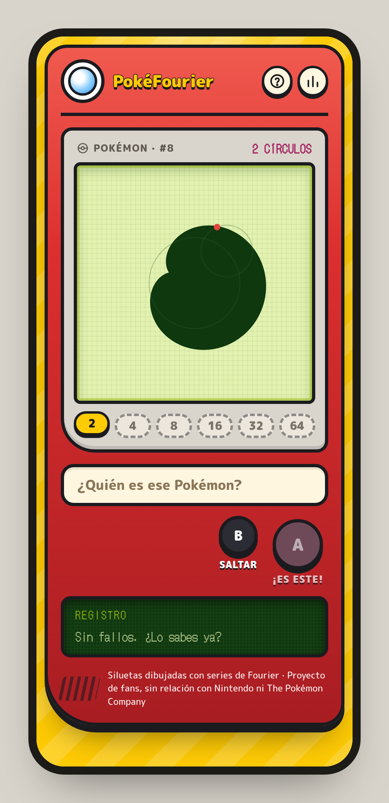
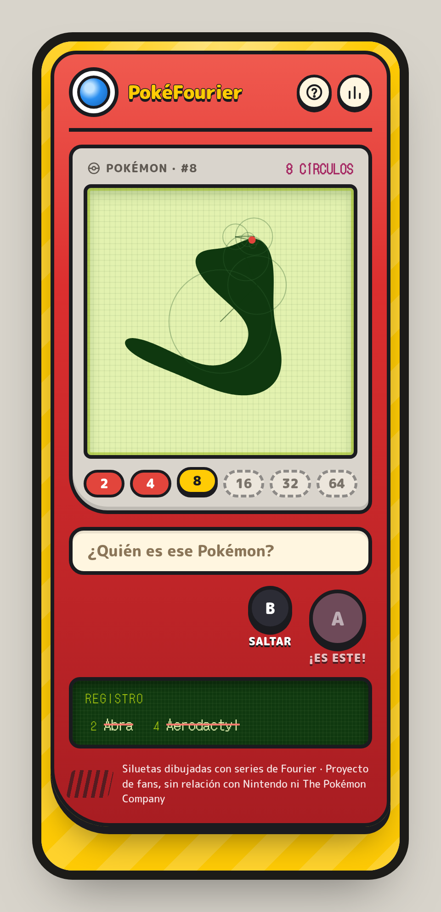
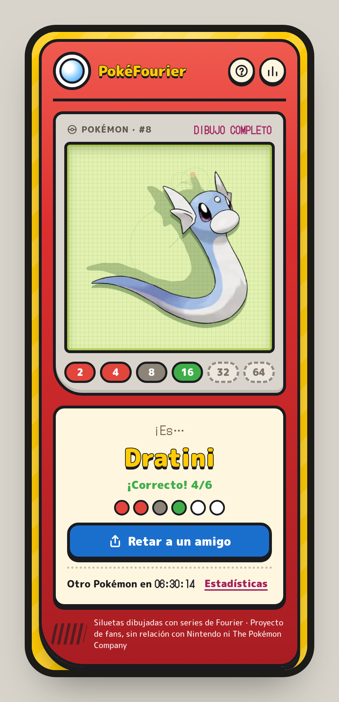
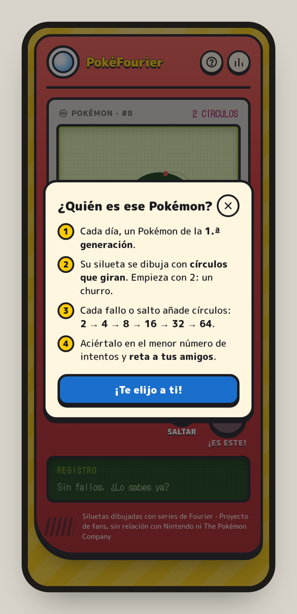
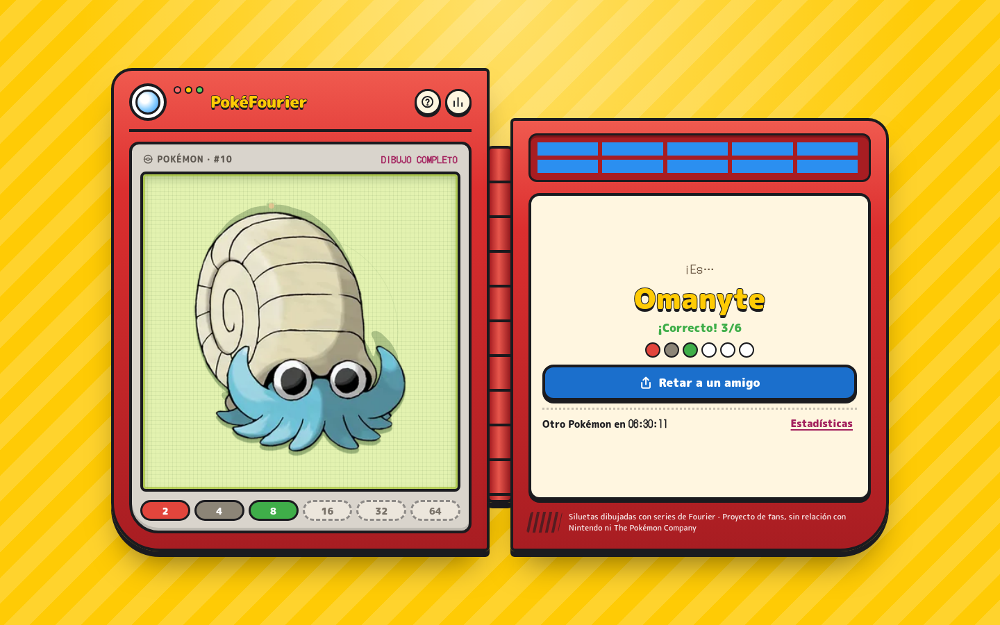

<div align="center">

# PokéFourier

**¿Quién es ese Pokémon? La silueta del día se dibuja sola con círculos que giran.**

Empieza con 2 círculos y cada fallo o salto añade más: 2 → 4 → 8 → 16 → 32 → 64.
Al acabar se revela el Pokémon y puedes retar a un amigo con tu resultado.


</div>

> [!WARNING]
> **Prototipo privado para probar la idea. No publicar así.** El arte y los nombres de Pokémon
> tienen copyright de Nintendo / Game Freak / The Pokémon Company. Antes de publicar habría que
> sustituirlos (criaturas propias o imágenes con licencia libre); el motor no depende de ellos.

> [!NOTE]
> **Esta rama es un proyecto aparte.** Tiene su propio historial y no se fusiona con `main`. El
> juego de países y banderas está en [`main`](../../tree/main) y sus ramas de estilo. PokéFourier
> usa el mismo motor (contorno → Fourier → epiciclos) con otra personalidad: una Pokédex roja con
> pantalla LCD verde.

### El estilo: la Pokédex

Una Pokédex roja de dibujos animados, con contornos negros gruesos:

- **Pantalla principal** verde claro con rejilla de píxeles, como un LCD de consola portátil; ahí
  se dibuja la silueta.
- **Segunda pantalla** verde oscura para el registro de intentos. En escritorio lista los 6; en el
  móvil, solo los que ya has hecho.
- **La lente azul** parpadea cada vez que la pantalla dibuja algo nuevo.
- **La escalera de círculos** (2 → 64): lo que falta va en trazo discontinuo y el intento actual,
  en amarillo y algo levantado.
- **Botones A y B**: el A se enciende cuando hay un Pokémon válido escrito.
- Letra M PLUS Rounded 1c para el aparato y DotGothic16 (de píxeles) para lo que sale en las
  pantallas, ambas incluidas en `web/fonts/`.

---

## Cómo se juega

<table>
  <tr>
    <td align="center" width="33%"></td>
    <td align="center" width="33%"></td>
    <td align="center" width="33%"></td>
  </tr>
  <tr>
    <td align="center"><b>1. Una sombra</b><br>La silueta se dibuja con 2 círculos. Escribe un Pokémon o salta.</td>
    <td align="center"><b>2. Más círculos</b><br>Cada fallo afina la silueta. Tienes 6 intentos.</td>
    <td align="center"><b>3. ¡Es…!</b><br>Se revela el Pokémon y retas a un amigo sin destripárselo.</td>
  </tr>
</table>

<table>
  <tr>
    <td align="center" width="50%"></td>
    <td align="center" width="50%"></td>
  </tr>
  <tr>
    <td align="center"><b>Ayuda</b><br>Se abre sola la primera vez.</td>
    <td align="center"><b>Estadísticas</b><br>Racha y en qué intento sueles acertar. Se guardan en el navegador.</td>
  </tr>
</table>

### En escritorio: la Pokédex abierta

A la izquierda la pantalla; a la derecha el buscador, la cruceta, los botones **A** (¡es este!) y
**B** (saltar) y la segunda pantalla, verde oscura, con el registro de los 6 intentos (los hechos,
el de ahora y los que quedan). Se juega con el teclado: escribe en cualquier momento,
<kbd>Enter</kbd> para responder y <kbd>Esc</kbd> para borrar.



---

## Cómo funciona

Cualquier contorno cerrado se puede escribir como una suma de giros (una **serie de Fourier**).
Ordenando los círculos de mayor a menor, los primeros K dan la mejor aproximación con K círculos:


Lo nuevo respecto al juego de países es sacar el contorno **de una imagen**
([`pipeline/sources/image.py`](pipeline/sources/image.py)):

1. Máscara figura/fondo con la transparencia (o umbral de Otsu si no hay).
2. Cierre morfológico para unir grietas pequeñas.
3. Componente conexa más grande y relleno de agujeros.
4. Trazado del borde exterior con el algoritmo de vecinos de Moore.

Una convolución (Sobel, etc.) no basta: da píxeles de borde *sin orden*, y la DFT necesita
recorrer el contorno en orden. El resto (remuestreo, DFT, niveles, calendario, frontend) es el
mismo motor.

---

## Desarrollo

```powershell
python -m venv .venv
.venv\Scripts\Activate.ps1           # Linux/macOS: source .venv/bin/activate
pip install -r requirements.txt
python -m pipeline.download          # 151 imágenes (≈22 MB) a data/raw/pokemon/ (no se suben)
python -m pipeline.build             # contornos -> Fourier -> web/data/
python -m pipeline.art               # arte de la revelación (web/data/pokemon/art/)
python -m http.server 8005 --directory web
```

| Qué | Dónde |
|---|---|
| Juego | <http://localhost:8005/> (empieza el 19/11/2026) |
| Otro día | <http://localhost:8005/?fecha=2026-11-25> |
| Tests de JavaScript | <http://localhost:8005/dev/tests.html> |
| Cualquier estado, para capturas | `dev/capture.html?fecha=…&jugadas=fallo,salto&ancho=390` |

```powershell
pytest                                                     # tests del pipeline
python -m pipeline.preview --collection pokemon --levels   # cada silueta en cada nivel
python -m pipeline.screenshots                             # capturas de este README (docs/img/)
```

Parámetros (rango de Pokémon, niveles, calendario…) en [`config.toml`](config.toml). Para más
generaciones basta con cambiar `last` en `[images]`.

### Diferencias con el juego de países

- Estilos propios en `web/css/` (Pokédex en móvil, libro abierto en escritorio) y fuentes en `web/fonts/`.
- Revelación del arte al acabar (`ui.art` en la colección).
- Nombre y prefijo de guardado propios (`web/js/app/config.js`, `storage.js`).

## Ideas

- Pistas por intento (tipo, generación) como en otros juegos del nicho.
- Modo "sombra clásica": silueta rellena en negro sobre un fondo de rayos.
- Para publicarlo: criaturas propias con el mismo motor.
