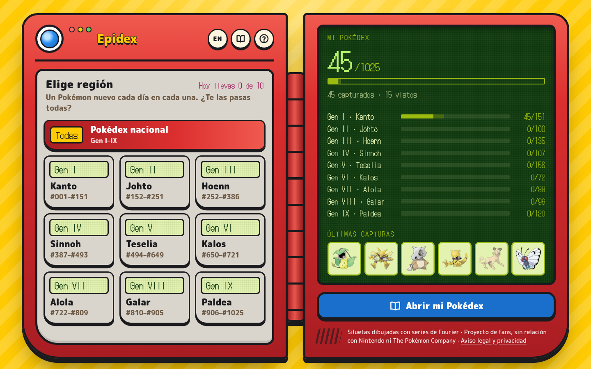
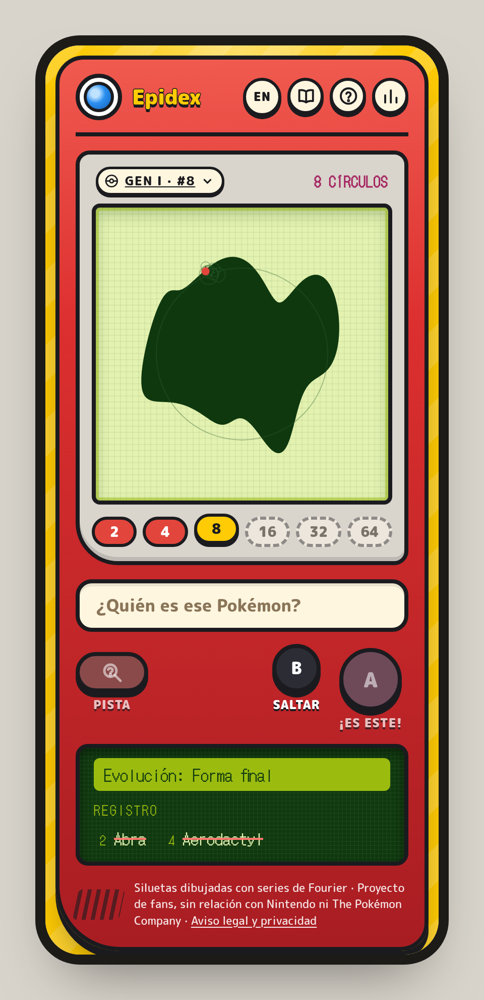
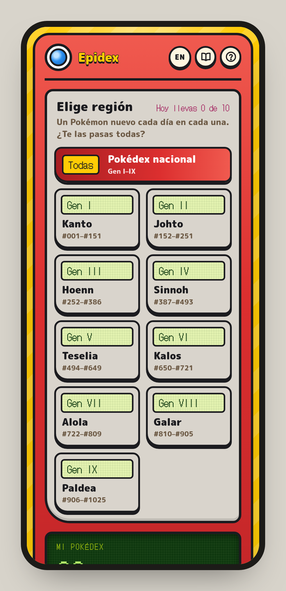
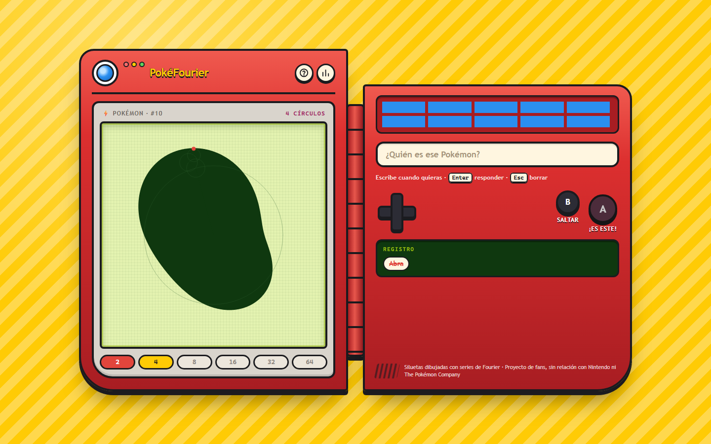
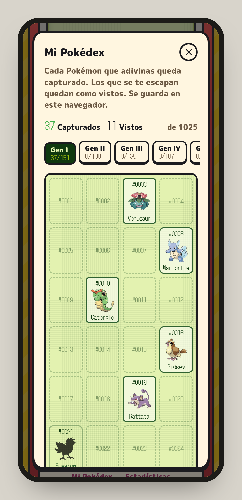
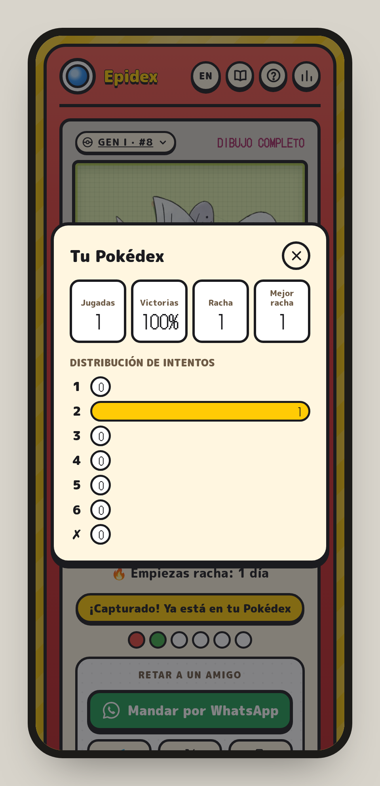
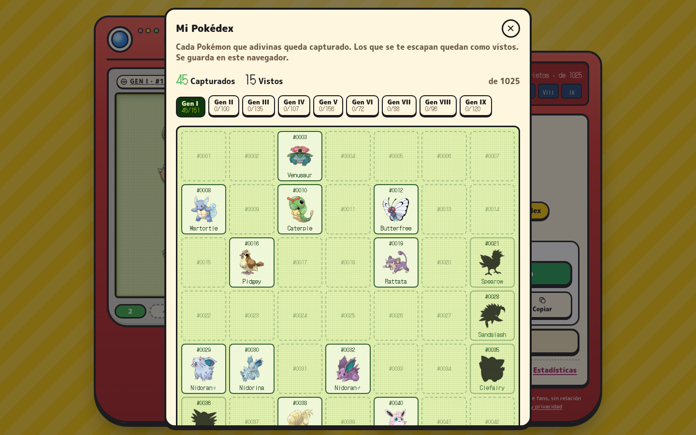
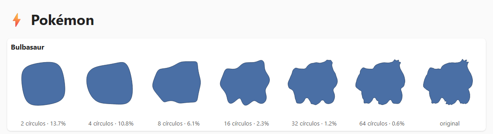

<div align="center">

# Epidex

**¿Quién es ese Pokémon? Su silueta se dibuja sola con círculos que giran.**

Un Pokémon nuevo cada día en cada región. Empieza con 6 círculos y cada fallo añade más:
6 → 10 → 16 → 24 → 40 → 64. Si te atascas, pide una pista. Los que adivinas van a tu Pokédex.



</div>

> [!WARNING]
> El arte y los nombres de Pokémon tienen copyright y son marcas de Nintendo / Creatures /
> GAME FREAK / The Pokémon Company. La web lleva aviso de proyecto de fans y una página de aviso
> legal con vía de retirada (`/legal/`), pero eso **no da permiso** para usarlos: si los titulares
> lo piden, hay que retirarlos. El motor no depende de ellos (sirve con criaturas propias).

**El nombre**: *Epidex* = epiciclo + Pokédex, sin «Poké», que es marca registrada.

## Cómo se juega

<table>
  <tr>
    <td align="center" width="33%"></td>
    <td align="center" width="33%"></td>
    <td align="center" width="33%"></td>
  </tr>
  <tr>
    <td align="center"><b>1. Una sombra</b><br>La silueta se dibuja con 6 círculos. Escribe un Pokémon o salta.</td>
    <td align="center"><b>2. Más círculos y una pista</b><br>Cada fallo afina la silueta. Tienes 6 intentos y una pista.</td>
    <td align="center"><b>3. ¡Es…!</b><br>Se revela el Pokémon y retas a un amigo sin destripárselo.</td>
  </tr>
</table>

### Menú principal: regiones y tu Pokédex

La portada (`/`) es el menú principal. A un lado, un cartucho por región (de Kanto a Paldea,
Gen I a IX) y uno con **todas mezcladas** (1025 Pokémon); al otro, **tu Pokédex**: cuántos llevas,
una barra por generación y tus últimas capturas. Cada región tiene su Pokémon del día, su
calendario, su racha y sus estadísticas, y su cartucho enseña cómo te ha ido hoy (✓ 3/6, ✗ o a
medias). Al elegir una se juega en `?modo=gen1`, `?modo=all`…, que es también el enlace que se
comparte. La etiqueta de la pantalla (`GEN I · #10 ▾`) y «Volver al menú» llevan de vuelta.

<table>
  <tr>
    <td align="center" width="50%"></td>
    <td align="center" width="50%"></td>
  </tr>
  <tr>
    <td align="center"><b>Móvil</b><br>Regiones arriba y tu Pokédex debajo.</td>
    <td align="center"><b>Escritorio</b><br>La Pokédex abierta como un libro.</td>
  </tr>
</table>

### Se adapta a cada pantalla

En el móvil, las dos mitades de la Pokédex van una encima de otra y ocupan todo el ancho; en una
tablet en vertical, igual pero más grandes. En el ordenador la Pokédex se abre como un libro y se
amplía o reduce (con `zoom`, en [`web/js/ui/fit.js`](web/js/ui/fit.js)) para llenar la ventana
sin scroll, desde un portátil de 1280×720 hasta un monitor grande; se reajusta sola al cambiar de
tamaño o de contenido (al acabar la partida, al pedir la pista…).

### Pistas: una por partida, al azar

La tecla **Pista** (a la izquierda de B y A) enseña en la pantalla del registro **una** de las pistas
que tiene ese Pokémon, elegida al azar (la misma para todo el mundo ese día):

| Pista | Ejemplo (Pikachu) |
|---|---|
| Tipo | Eléctrico |
| Evolución | Fase inicial · Forma intermedia · Forma final · No evoluciona |
| Categoría | Pokémon Ratón |
| Color | Amarillo |
| Tamaño | 0,4 m · 6 kg |
| Inicial | Empieza por «P» |
| Generación | Gen I · Kanto (solo con todas mezcladas) |

No gasta intento, pero queda en el resultado que compartes («Con pista: Evolución» o
«Sin pistas»). Los datos salen de PokeAPI y van dentro de cada puzzle (`hints`).

### Tu Pokédex

Cada Pokémon que adivinas queda **capturado** en tu Pokédex, con su ilustración; los que se te
escapan quedan como **vistos**, en silueta. Capturar es para siempre: fallar después contra el
mismo Pokémon no lo baja a visto. Su resumen está en el menú principal, y la Pokédex completa se abre
con el botón del libro, desde el resultado o, durante la partida en escritorio, desde la tapa
derecha, donde hay una tecla por generación que se va llenando.

<table>
  <tr>
    <td align="center" width="50%"></td>
    <td align="center" width="50%"></td>
  </tr>
  <tr>
    <td align="center"><b>Mi Pokédex</b><br>Una pestaña por generación: 1025 casillas para llenar.</td>
    <td align="center"><b>Estadísticas</b><br>Racha y en qué intento sueles acertar.</td>
  </tr>
</table>

Todo (partidas, rachas, estadísticas y Pokédex) se guarda en el navegador, sin cuentas ni
servidor: si borras los datos del sitio, se pierde.

### Compartir

Al acabar, un botón grande de **WhatsApp** abre la app con el mensaje ya escrito, y debajo hay
Telegram, X, Copiar y «Más» (la hoja de compartir del sistema, solo con HTTPS). El mensaje no
destripa la respuesta:

```
Epidex · Gen I #12
🟥⬛🟩⬜⬜⬜
✅ ¡Capturado en 3/6!
💡 Con pista: Tipo
https://…
```

### En escritorio: la Pokédex abierta

A la izquierda, la pantalla con la silueta lo más grande que cabe. A la derecha, de arriba abajo:
tu Pokédex, el buscador, las teclas **Pista**, **B** (saltar) y **A** (¡es este!) y la segunda
pantalla con la pista y el registro de los 6 intentos. Se juega con el teclado: escribe en
cualquier momento, <kbd>Enter</kbd> para responder y <kbd>Esc</kbd> para borrar.



### El estilo

Una Pokédex roja con contornos negros gruesos, la pantalla LCD verde de las consolas portátiles
(rejilla de píxeles y letra de puntos DotGothic16) y M PLUS Rounded 1c para el aparato. La lente
azul parpadea cada vez que la pantalla dibuja algo nuevo; la escalera de círculos marca el intento
actual en amarillo. Las fuentes van incluidas en `web/fonts/`.

---

## Cómo funciona

Cualquier contorno cerrado se puede escribir como una suma de giros (una **serie de Fourier**).
Ordenando los círculos de mayor a menor, los primeros K dan la mejor aproximación con K círculos:



El contorno sale **de la ilustración** ([`pipeline/sources/image.py`](pipeline/sources/image.py)):

1. Máscara figura/fondo con la transparencia (o umbral de Otsu si no hay).
2. Cierre morfológico para unir grietas pequeñas.
3. Componente conexa más grande y relleno de agujeros.
4. Trazado del borde exterior con el algoritmo de vecinos de Moore.

Una convolución (Sobel, etc.) no basta: da píxeles de borde *sin orden*, y la DFT necesita
recorrer el contorno en orden. Después: remuestreo, DFT, niveles y calendario.

---

## Desarrollo

```bash
python -m venv .venv
source .venv/bin/activate              # Windows: .venv\Scripts\Activate.ps1
pip install -r requirements.txt
python -m pipeline.pokemon_collections # modos y pistas desde PokeAPI (data/)
python -m pipeline.download            # 1025 imágenes (≈130 MB) a data/raw/pokemon/ (no se suben)
python -m pipeline.build               # contornos -> Fourier -> web/data/ y páginas (≈10 min)
python -m pipeline.art                 # arte de la revelación (web/data/<modo>/art/)
python -m pipeline.serve               # http://localhost:8005/, sin caché (ver abajo)
```

| Qué | Dónde |
|---|---|
| Menú principal | <http://localhost:8005/> (inglés) y <http://localhost:8005/es/> |
| Jugar una región, otro día | `?modo=gen3`, `?modo=all&fecha=2026-11-25` |
| Tests de JavaScript | <http://localhost:8005/dev/tests.html> |
| Cualquier estado, para capturas | `dev/capture.html?modo=gen1&jugadas=fallo,pista:type&pokedex=40&ancho=390` (sin `modo`, el menú) |

```bash
pytest                                                     # tests del pipeline
ruff check . && ruff format --check .
python -m pipeline.preview --collection gen1 --levels      # cada silueta en cada nivel
python -m pipeline.screenshots                             # capturas de este README (docs/img/)
```

`pipeline.screenshots` busca Chrome o Edge; si no lo encuentra, indícalo con la variable `CHROME`.

Usa `python -m pipeline.serve` y no `python -m http.server`: este último no manda cabeceras de
caché, el navegador se guarda los módulos JS durante horas y, tras un cambio, mezcla archivos
nuevos con viejos y el juego se queda en «Encendiendo la Pokédex…». Si te pasa, recarga con
<kbd>Ctrl</kbd>+<kbd>Mayús</kbd>+<kbd>R</kbd>. En la web publicada no ocurre: Cloudflare Pages
revalida cada archivo.

### Dónde está cada cosa

| | |
|---|---|
| [`config.toml`](config.toml) | Niveles, calendario, rango de imágenes, web y datos del aviso legal |
| `data/collections/` | Los modos (`gen1.json` … `gen9.json`, `all.json`) |
| `data/pokemon_hints.json` | Pistas de los 1025 (tipo, evolución, categoría, color, tamaño…) |
| [`pipeline/pokemon_collections.py`](pipeline/pokemon_collections.py) | Genera los dos anteriores desde PokeAPI |
| [`site/page.html`](site/page.html), [`site/strings.json`](site/strings.json) | Plantilla y textos de la página (no edites `web/index.html`) |
| `web/js/core/` | Lógica pura con tests: reglas, pistas, Pokédex, estadísticas, texto para compartir |
| `web/js/app/`, `web/js/ui/` | Controlador, guardado, idiomas y piezas de interfaz |
| `web/css/` | Tokens, componentes y la versión de escritorio |

Si sale una generación nueva: añade su región en `pipeline/pokemon_collections.py`, sube `last`
en `[images]` y el rango en `GENERATION_RANGES` de `web/js/core/dex.js`.

### Idiomas y SEO

El juego está en **inglés** (raíz, `/`) y en **español** (`/es/`). Las dos páginas se generan
desde la plantilla, cada una con su título, descripción, imagen para compartir (`web/og/`), datos
estructurados y un texto con cómo se juega y preguntas frecuentes. La primera vez, quien llega con
el navegador en español pasa solo a `/es/`; el botón `ES`/`EN` lo cambia. Con dominio en
`[site] url` se añaden URL canónica, `hreflang` y `sitemap.xml`.

### Publicar

Es una web estática: se publica `web/` **sin `web/dev/`** (demos que enseñan las respuestas), por
ejemplo en Cloudflare Pages conectado al repo, sin comando de build (o `rm -rf web/dev`) y con
`web` como carpeta de salida. `web/data/` se genera en local y se sube.

Antes de publicar:

- Rellena `[site.legal]` en `config.toml` (titular y correo; `build` avisa si faltan).
- Pon el dominio en `[site] url` para que la vista previa de los enlaces lleve imagen.
- Con anuncios: `ads = true` y, en la UE, un aviso de cookies con consentimiento (CMP certificado
  por Google si son de AdSense) que cargue los anuncios solo tras aceptar.

## Licencia

**Todos los derechos reservados.** El código y el diseño del juego son del autor y no se pueden
usar, copiar, modificar ni publicar sin su permiso por escrito; ver [`LICENSE`](LICENSE).
Pokémon y todo su material son de Nintendo / Creatures / GAME FREAK / The Pokémon Company; los
nombres, generaciones y datos de las pistas, de [PokeAPI](https://github.com/PokeAPI/pokeapi)
(BSD-3), y las fuentes, con licencia SIL OFL.
